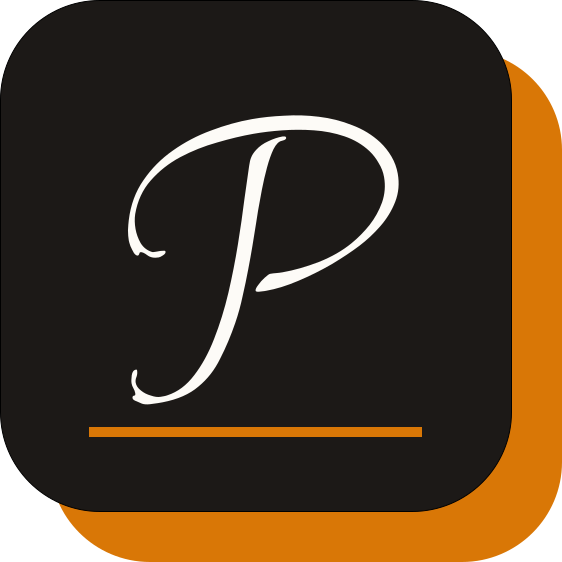

# Papyrus

A minimalist, self-hosted exam prep archive built by students, for students.
 

LIVE DEMO: [https://papyrus.steve.hackclub.app](https://papyrus.steve.hackclub.app)

## Vision & Motivation

As a student who has navigated the board exam phase, I found that practicing past papers was one of the single most effective preparation tools. However, high-quality papers were often scattered across obscure websites or hidden behind paywalls. My friends and I spent countless hours scouring the internet just to find complete, clean PDFs.

**Papyrus** was created to eliminate that friction. By centralizing authentic exam papers and study materials into a fast, zero-distraction archive, Papyrus helps students focus on what actually matters: effective preparation.

---

## Architecture & Tech Stack

Papyrus is built as a unified Next.js application, combining frontend rendering and backend API routes in a single lightweight codebase.

* **Framework:** Next.js (App Router) & TypeScript
* **Styling:** Vanilla CSS & Lucide Icons
* **Database:** Bun SQLite (`db/schema.sql`)
* **Storage:** Local PDF file storage

---

## Main Pages

* **Home Page:** A clean, distraction-free landing page with quick access to the archive
* **Archive Page:** Browse, filter, and search through cataloged board papers effortlessly.
* **Pin Board:** Pin and bookmark key papers for quick access during study sessions.
* **Community Uploads:** Submit papers and study materials for review.
* **Paper Viewer:** View PDFs and details directly in the browser with a distraction-free interface.
* **Admin Dashboard:** Review pending submissions, manage archives, and see statistics.
  * **Moderation Tools:** Approve or reject submissions, and manage user contributions.
  * **Board Studio:** Create and manage boards, including subjects, and grades.
  * **Paper Studio:** Add, edit, and manage papers, including metadata and file uploads.
* **Customizable Settings:** Short and quick access to user preferences.

---

## Contributing

We welcome community contributions, whether you are submitting code or sharing study materials!

### 1. Contributing Code
Papyrus is open-source. To maintain code quality and maintainability:
* **Human Oversight Required:** We strictly prohibit unreviewed AI-generated slop. While AI tools can assist your workflow, all pull requests must be thoroughly reviewed, tested, and accompanied by clear, human-written documentation and explanations.

### 2. Contributing Papers & Materials
To submit papers for the archive, use the in-app **Upload** page. All submissions undergo a manual review process before being published to ensure quality.

When submitting materials, please ensure:
1. **Rights & Permissions:** Only submit materials you have the right to share. Do not upload copyrighted commercial content.
2. **Accurate Metadata:** Include clear details (Subject, Grade/Class, Board, Exam Year, and Chapter/Topic).
3. **Format & Integrity:** Upload clean, readable PDFs (Preferably soft copies) that are not password-protected or corrupted.
4. **Patience:** Manual review takes a little time, but approved submissions will be cataloged promptly!

---

## Data Flow & Storage

The papers have a neraly linear flow from submission to approval, ensuring quality and integrity of the archive:
1. It starts with a user uploading a PDF through the **Community Uploads** page.
2. The submission is stored in a temporary location and flagged for review.
3. Admins review the submission, checking for quality, accuracy, and compliance with guidelines.
4. Approved submissions are moved to the main archive, and metadata is stored in the SQLite database. (Refer [db.md](./db.md) to see about that)
5. Users can then browse, search, and view the approved papers in the archive.

The feedback loop is closed by allowing users to report issues with papers, which are then reviewed by admins. This data is stored in the database for tracking and improvement of the archive.